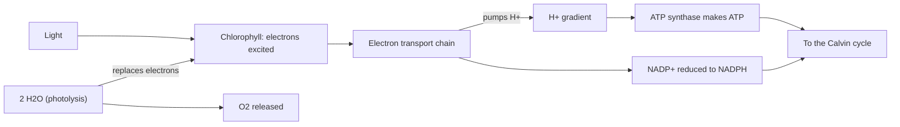

# Photosynthesis

> Biology 101 · Sources: S1 · 2026-10-23 · Check anything important against your materials.

## Overview

**Photosynthesis** is how plants, algae and cyanobacteria turn light energy into chemical energy stored in sugars [S1 ¶1]. These organisms are **autotrophs** (**producers**): they make their own food from inorganic molecules, so almost every food chain starts with them, and the oxygen in the air was released by photosynthesis [S1 ¶1]. It happens in two linked stages, the light-dependent reactions and the Calvin cycle [S1 ¶2].

## Core exam content

### 1. The overall equation

$$6\,\mathrm{CO_2} + 6\,\mathrm{H_2O} \xrightarrow{\text{light energy}} \mathrm{C_6H_{12}O_6} + 6\,\mathrm{O_2}$$

- Inputs: **carbon dioxide** and **water**; outputs: **glucose** and **oxygen** [S1 ¶2].
- It is a **summary** of many smaller steps, not a single reaction [S1 ¶2].

### 2. Where it happens

- Inside **chloroplasts**, mostly in the **mesophyll cells** of leaves [S1 ¶3].
- CO₂ enters through **stomata** (small pores); water arrives from the roots through the **xylem** [S1 ¶3].

| Part of the chloroplast | What it is | Role in photosynthesis |
|---|---|---|
| Double membrane | Envelope around the chloroplast | Encloses the stroma [S1 ¶3] |
| **Stroma** | The fluid inside | Site of the Calvin cycle [S1 ¶3, ¶7] |
| **Thylakoids** | Flattened membrane sacs, stacked into **grana** | Membranes hold chlorophyll; site of the light-dependent reactions [S1 ¶3-¶5] |

- **Chlorophyll** (green pigment in the thylakoid membranes) absorbs mainly **red and blue** light and reflects **green**, which is why leaves look green [S1 ¶4].

### 3. Stage 1: the light-dependent reactions (thylakoid membranes)

1. Light **excites electrons** in chlorophyll molecules grouped into **photosystems** [S1 ¶5].
2. The excited electrons pass along an **electron transport chain**; the energy released **pumps protons (H⁺)** into the thylakoid space [S1 ¶5].
3. Protons flow back out through **ATP synthase**, which uses the flow to make **ATP** [S1 ¶5].
4. At the end of the chain, electrons **reduce NADP⁺ to NADPH** [S1 ¶5].
5. Chlorophyll's lost electrons are replaced by **photolysis**, splitting water [S1 ¶6]:

$$2\,\mathrm{H_2O} \rightarrow 4\,\mathrm{H^+} + 4\,e^- + \mathrm{O_2}$$

- The released **oxygen comes from water, not from CO₂**. Experiments labelling water with a heavy oxygen isotope showed the label ends up in the released O₂ [S1 ¶6].

### 4. Stage 2: the Calvin cycle (stroma)

- Doesn't use light directly ("light-independent reactions") but **depends on ATP and NADPH from stage 1**, so it **stops soon after the plant is put in the dark** [S1 ¶7].

| Phase | What happens | Uses |
|---|---|---|
| **Carbon fixation** | **Rubisco** attaches CO₂ to **RuBP** (5-carbon); the unstable 6-carbon product splits into two **3-PGA** (3-carbon) [S1 ¶7] | CO₂ |
| **Reduction** | 3-PGA is converted into **G3P** (3-carbon sugar) [S1 ¶8] | **NADPH supplies electrons**, **ATP supplies energy** [S1 ¶8] |
| **Regeneration** | Most G3P is used to rebuild RuBP so the cycle continues [S1 ¶8] | More ATP |

- For every **3 CO₂ fixed, 1 G3P leaves** the cycle; plants build glucose, sucrose, starch and other organic molecules from it [S1 ¶8].
- One glucose = **2 G3P = 6 turns** of the cycle [S1 ¶8].

### 5. Comparing the two stages (the lecturer's exam tip [S1 ¶11])

| | Light-dependent reactions | Calvin cycle |
|---|---|---|
| Location | Thylakoid membranes [S1 ¶5] | Stroma [S1 ¶7] |
| Inputs | Light, water, NADP⁺ [S1 ¶5-¶6] | CO₂, ATP, NADPH [S1 ¶7-¶8] |
| Outputs | ATP, NADPH, O₂ [S1 ¶5-¶6] | G3P (used to make glucose and other molecules) [S1 ¶8] |
| Needs light? | Directly | Not directly, but stops in the dark because it runs out of ATP and NADPH [S1 ¶7] |

### 6. Limiting factors

- Rate depends mainly on **light intensity**, **CO₂ concentration** and **temperature** [S1 ¶9].
- **Limiting factor**: whichever is in shortest supply; raising the other two won't increase the rate until it's raised [S1 ¶9].
- Temperature matters because the Calvin cycle depends on **enzymes** such as Rubisco: the rate rises to an **optimum**, then falls as enzymes **denature** [S1 ¶9].

## Side remarks

- Jan van Helmont's willow experiment (1600s): the tree gained a lot of mass while the soil lost almost none; he concluded the mass came from water. Most dry mass actually comes from CO₂ in the air. Marked by the lecturer as **not examined** [S1 ¶10].

## Common mistakes

- **Oxygen comes from water, not CO₂** [S1 ¶6].
- **ATP vs NADPH in the Calvin cycle**: NADPH provides the **electrons**, ATP provides the **energy** [S1 ¶8].
- "Light-independent" doesn't mean "works in the dark": the Calvin cycle stops soon without light, because ATP and NADPH run out [S1 ¶7].
- Stroma vs thylakoid: Calvin cycle in the **stroma**, light-dependent reactions in the **thylakoid membranes** [S1 ¶5, ¶7].

## Likely exam questions

1. Compare the light-dependent reactions and the Calvin cycle by location, inputs and outputs. (§5)
2. Explain why the Calvin cycle stops soon after a plant is placed in the dark. (§4, §5)
3. Describe how light energy ends up stored in ATP and NADPH. (§3)
4. Where does the oxygen released by photosynthesis come from, and what evidence shows this? (§3)
5. Explain the role of Rubisco in the Calvin cycle. (§4)
6. How many turns of the Calvin cycle are needed to make one glucose molecule, and why? (§4)
7. Explain what a limiting factor is, using an example. (§6)

## Sources

- S1: Photosynthesis handout, week 5 (¶1–¶11)

---

Want a quick quiz on this (`/study:quiz photosynthesis`) or flashcards (`/study:flashcards photosynthesis`)?
